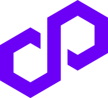
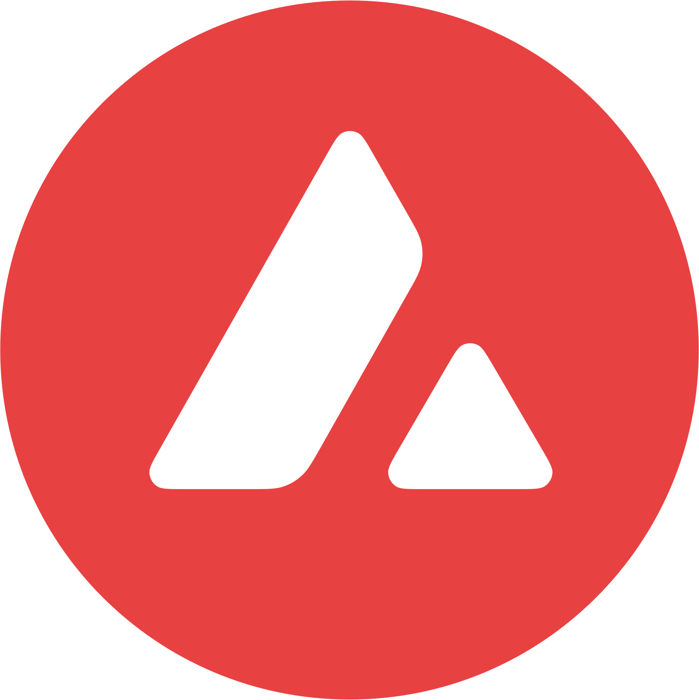
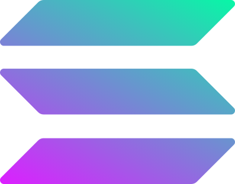
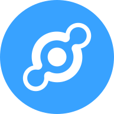
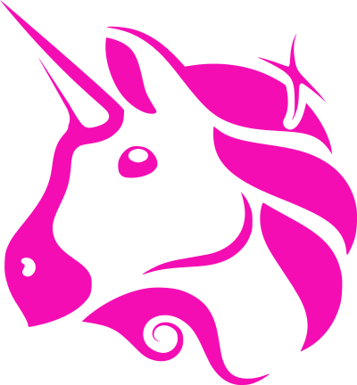

# Arkessiah

  

###

  

###

<h1 align="center">Hey there 👋</h1>

###

<h3 align="left">🧑‍💻  About Me</h3>

###

I'm Antonio from Spain  - 🔭 My specialty is Innovation, Blockchain, AI and Software Development.  - 🛰️ Lately I build AI agents, quantum and post-quantum software, drone firmware and 3D-printed hardware.  - 📚 I am always learning and updating myself.  - ⚡ I have great skills in both hands-on engineering and technical management.

###

<h3 align="left">💻 Languages</h3>

###

  <picture>
    <source media="(prefers-color-scheme: dark)" srcset="https://skillicons.dev/icons?i=ts,js,solidity,py,go,rust,cpp,c,bash&theme=dark" />
    
  </picture>

###

<h3 align="left">⚛️ Frameworks & Libraries</h3>

###

  <picture>
    <source media="(prefers-color-scheme: dark)" srcset="https://skillicons.dev/icons?i=react,nextjs,nodejs,express,tailwind,django,svelte,materialui,fastapi,flask,tauri&theme=dark" />
    
  </picture>
   
  
  

###

<h3 align="left">🤖 AI & Machine Learning</h3>

###

  <picture>
    <source media="(prefers-color-scheme: dark)" srcset="https://skillicons.dev/icons?i=pytorch,tensorflow,sklearn,opencv&theme=dark" />
    
  </picture>
   
  
  
  

###

<h3 align="left">🧠 LLMs & AI Agents</h3>

###

  
  
  
  
  
  
  
  
  
  
  
  
  

###

<h3 align="left">🧭 Agent Frameworks</h3>

###

  
  
  
  
  
  
  

###

<h3 align="left">🔬 Exploring: Decision Models</h3>

###

  
  

###

<h3 align="left">⚛️ Quantum Computing</h3>

###

  
  
  
  

###

<h3 align="left">🛸 Drones, Embedded & RF</h3>

###

  
  
  
  
  
  
  
  
  
  
  

###

<h3 align="left">🖨️ 3D Printing & CAD</h3>

###

  
  
  
  

###

<h3 align="left">⛓️ Blockchain & Web3</h3>

###

  
  
  
  
  
  
  
  
  <picture>
    <source media="(prefers-color-scheme: dark)" srcset="assets/icons/arweave-light.svg" />
    
  </picture>
  
  
  
  
   
  
  
  
  
  
  
  
  
  
  
  
  
  

###

<h3 align="left">🔧 DevOps & Cloud</h3>

###

  <picture>
    <source media="(prefers-color-scheme: dark)" srcset="https://skillicons.dev/icons?i=docker,git,github,gitlab,aws,gcp,nginx,jenkins&theme=dark" />
    
  </picture>

###

<h3 align="left">💾 Databases</h3>

###

  <picture>
    <source media="(prefers-color-scheme: dark)" srcset="https://skillicons.dev/icons?i=mongodb,postgres,mysql,redis,firebase,sqlite&theme=dark" />
    
  </picture>
   
  

###
